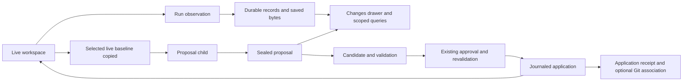

# Run changes and isolated proposals: Loom integration plan

Date: 2026-10-13. Status: researched proposal; no runtime implementation in this task.

## Decision and user outcome

Keep Git. Add a durable record of workspace changes associated with each execution attempt, then an optional workflow for generating and applying isolated proposals. The first useful release lets a human or a successor agent answer: what changed, what evidence links it to this run, which bytes were reviewed or tested, and whether those bytes still match the current workspace.

Conversation branching remains conversation topology. A conversation fork does not create a filesystem branch. A completed agent result does not mean its proposal was applied, reviewed, tested, or committed.

Build in four stages: durable observations; review and bounded retrieval; isolated proposals; guarded application. Stages 1 and 2 provide value independently and should ship before application is enabled.

## Research basis

[Anthropic's Scion article](https://www.anthropic.com/engineering/redesigning-source-control) describes immutable changesets, content-addressed data, server-side repository queries, and optional sparse working copies at an unusually large development scale. Borrow the durable identity and query patterns. Loom's workload does not justify replacing Git, deploying distributed caches, introducing a virtual filesystem, or adopting a policy of fixing conflicts after integration. Proposal review below is our design for Loom, not a feature supplied by Scion.

Three read-only Loom-managed research jobs were requested with `harness=gemini`, `model=Gemini 3.8 Flash (High)`. Their launch records resolve the selector to `gemini-3.8-flash-high`; that is harness-reported identity, not independent backend verification.

All three jobs reached `completed` with no recorded terminal error. The parent used `wait_agent` and `get_agent` to collect their returned reports and reconcile recommendations with current source. Their original results remain available in the Agents panel under the run IDs below.

| Research | Durable run ID | Contribution |
| --- | --- | --- |
| Storage and lifecycle | `bff63860-fd7d-4057-9738-11ef3b8d6c5b` | Snapshot, journal, persistence, child-run and crash gaps |
| Isolation and application | `84839543-1c33-4ec8-b972-f356e482c430` | Alternatives, dirty baseline, Windows and integration concerns |
| Review and APIs | `b9241b46-d2ff-4ed4-9a04-e0875472d0f5` | UI, scoped delivery, API and disclosure design |

Parent review checked the live files listed below. These include pre-existing local edits; Git HEAD was not substituted for the working files. Research-agent prose is supporting analysis, not proof of implementation or successful tests.

## Existing foundations and concrete gaps

| Live implementation inspected | What can be reused | What this plan adds |
| --- | --- | --- |
| `workspace_safety.py`: `_workspace_paths`, `_collect_files`, `_store_blob`, `capture_workspace_snapshot`, `finalize_workspace_snapshot` | External SHA-256 blob store, fingerprints, before/after manifests, exact file bytes, skipped coverage, preserved post-turn output | Durable indexing, sealed attempt identity, scoped child capture, bounded diff access |
| `server.py`: `_handle_generation_with_workspace_safety` (around 8083) | Common top-level capture/finalize boundary and preparation timeout | Persist capture identity before launch; preserve ownership beyond adapter cleanup; query after reconnect |
| `server.py`: `_launch_agent_run` (around 536); `agent_supervisor.py`: `_run_one` | Durable child execution, result persistence, cancellation and confirmed teardown | Independent child capture and attempt IDs, including children outliving their parent |
| `workspace_integrity.py`: `prepare_integrity_check`, `revalidate_integrity` | Verified preimages for surfaced structured writes, one-time replacement/deletion review, stale-approval refusal | Link journals to attempts and tool outcomes; explicit evidence grades |
| `mcp_loom_workspace.py`: `_write_if_current`, `apply_unified_patch` | Exclusive creates, individual atomic replacements, hash rechecks, CRLF preservation | Successful broker mutation receipts; eventual application journal across multiple files |
| `database.py`: `agent_runs`, `agent_events`, `conversation_generation_leases`, message draft binding | Existing run/message/lease ownership and transactions | Additive change-record tables; no mutation of conversation topology |
| `event_router.py`: `canonical_run_id`, `RUN_SCOPED_KINDS`; `server.py`: `_ws_send` | `workspace_change_report` already requires an exact run subscription | Durable event references and explicit frozen identity for late finalization |
| `static/chat.js`: `workspace_change_report` handler (around 2781), `_renderWorkspaceNotifItem` | Current toast and notification containing counts and a few paths | Persistent Changes drawer with file and evidence views |
| `static/chat-workspace.js`; `static/admin/admin-landed.js` | Existing workspace panes and browser-local review marks | Entry points to the same record without changing cursors or granting approval |
| `context_runtime.py`; `context_scope_lifetime.py` | Task-owned retrieval lifetimes and handoffs | Small change-record references in handoff evidence, fetched only when needed |
| `agent_access.py`; `loom_auth.py`; `server.py` agent route registration | Scoped structured tools, sensitive-result projection and current network/credential checks | Purpose-specific read capabilities and disclosure filtering for saved content |

Current recovery captures Git-visible files after explicit exclusions, plus bounded Canvas traversal. Other ignored targets rely on surfaced pre-write journals. Current limits are 8 MiB per file, 256 MiB of newly read bytes per capture, 4,096 Canvas entries and 500 displayed report entries. These are coverage limits, not proof that an entire workspace was captured. The full after-manifest survives report truncation.

The top-level wrapper writes report JSON and emits a WebSocket event; it has no durable change-record lookup. Child launch does not independently call snapshot capture/finalization, although a live parent snapshot can observe child writes and structured approvals can journal them.

## Evidence and identity contract

Represent three facts separately, per file:

1. **Observed change:** captured before and after bytes differ. The observation belongs to an execution window; authorship is unknown.
2. **Recorded mutation:** a tool request/outcome is associated with the run. A preservation journal alone proves a preimage was saved, not that the proposed operation ran. Native tool outcomes are provider-reported; a broker receipt records its own checked mutation and postimage. Subsequent edits can supersede that postimage.
3. **Proposal change:** an independent execution directory differs from its frozen baseline. Its run supplies the proposed output, but directory separation does not prove that no other process interfered or that all effects were confined there.

Use a new UUID `change_id` as durable identity and a new UUID `attempt_id` per admitted execution attempt. Bind conversation, thread, parent message, draft message when available, logical workspace key, execution root, host/database identity, existing namespaced wire run ID and optional generation lease ID. Every child resume starts a new attempt while retaining its existing child run ID. Provider retries within an attempt retain separate tool identities/evidence references.

Neither `gen:N` nor a bare child run ID is the change table's primary key. `_gen_seq` restarts with the host; a child can resume under the same UUID. Top-level parallel runs may have no serial generation lease, so a lease alone is insufficient. A stable UUID plus the message/run bindings covers all three cases.

Record provider outcome, capture completeness, review mark, validation and application state independently. `unknown`, `unavailable`, `incomplete` and `no observed changes` must remain distinguishable. Never infer successful validation or a commit from assistant prose.

## Stage 1: durable observation records

### Storage and service boundary

Introduce `workspace_changes.py` to own capture registration, sealing, projection, lookup and reconciliation. Keep byte capture and recovery in `workspace_safety.py`; use the existing configured external recovery root and blob layout. Do not duplicate private blobs into project files, conversation messages or Search Space.

Add these tables through the existing idempotent database migration mechanism:

- `workspace_change_records`: UUID primary key, unique attempt UUID, all ownership bindings, before/after manifest references and digests, capture timestamps, execution outcome, coverage metadata, capture state and bounded diagnostic code.
- `workspace_change_files`: `(change_id, normalized_relative_path)` key, created/modified/deleted/unverified state, explicit before/after existence states, digests and sizes, text/binary classification, dirty-before flag and evidence grade. This is a derived index of complete saved artifacts, not the capped notification array.
- `workspace_change_evidence`: immutable record ID, attempt/change owner, evidence kind, tool/request/event identity, exact subject digest, result status and local output reference. Initially supports journal/outcome references; trusted validation-runner receipts can be added later.

Keep absolute recovery locations server-private. Read APIs accept change IDs and normalized file identifiers, never arbitrary blob paths or a bare hash that could bypass ownership checks. Before serving a blob, verify its digest; the existing warm cache's file-size check alone is insufficient to trust stored content for review or application.

### Lifecycle

Allocate attempt/change identity when execution is admitted. Register it before capture work; attach the draft later through the exact existing draft-creation path. Record baseline readiness before launching a provider. Ordinary shared execution keeps the current recovery-unavailable behavior and reports the gap; a proposal must have a verified baseline before launch.

Freeze identity in the service object instead of reconstructing it from a mutable conversation or `_generation_snapshots` during finalization. Provider handlers can clean up transient snapshots before the outer wrapper finishes. Publish using the frozen conversation/thread/run/draft binding.

Wrap independent child execution too. For declared access, capture the declared write targets, including permitted new files and explicit ignored targets, within stated bounds. Read-only children get an explicit record of read-only admission, without a bulk scan or a claim that OS writes are impossible. Legacy unrestricted children use the existing bounded inventory. Permissioned shell effects outside the captured target set remain unknown.

Finalize after acknowledged provider exit. A still-running child is recorded as overlapping its parent's window; parent totals and child totals must not be added as independent authored changes. If teardown is uncertain, retain the run reservation and mark capture pending/incomplete. Drain capture under bounded cancellation-safe ownership; do not release a cooperative writer reservation while its final bytes are still being captured.

Seal artifact references once. Existing finalizer paths are written atomically but are not a transaction across filesystem and SQLite; the new service must prevent a second finalization from replacing a saved endpoint with later live bytes. Use idempotent DB transitions and deterministic import from sealed manifests.

On restart, reconcile referenced records and stored artifacts without replaying tools. If a valid end artifact exists, finish indexing from those stored bytes. If only the baseline exists, mark the endpoint unknown/incomplete. A later scan can be a separately timestamped reconciliation observation; it cannot impersonate the original run's endpoint. Persist first, notify second; reconnect fetches durable records even if notification delivery was lost.

Start with full existing manifests. Delta-only manifests would complicate recovery-chain availability without a measured benefit; optimize later if manifest size or indexing costs warrant it.

### Exit criteria

Every admitted attempt has one addressable record. Completion, failure, cancellation, child resume, zero changes and missing coverage survive reconnect and restart. Saved before/after bytes remain readable after a later overwrite. A concurrent unrelated edit is shown as observed drift, not agent authorship.

## Stage 2: review and bounded agent retrieval

### Proposed REST contracts

| Endpoint | Result |
| --- | --- |
| `GET /api/conversations/{conv_id}/workspace-changes?thread_id=...&cursor=...&limit=...` | Stable paginated metadata for eligible attempts; browser may select a thread explicitly |
| `GET /api/workspace-changes/{change_id}` | Immutable ownership, status, coverage, evidence summary and artifact availability |
| `GET /api/workspace-changes/{change_id}/files?cursor=...&limit=...` | Complete paginated derived file records, including unverified states |
| `GET /api/workspace-changes/{change_id}/diff?file_id=...&cursor=...` | Saved UTF-8 diff hunks and explicit continuation/truncation; binary/oversize metadata otherwise |

Use stable keyset cursors tied to the immutable record/digest. Start at 100 entries per page, hard maximum 200, and 64 KiB per diff response; these are proposed defaults to benchmark. Bound diff input and computation too, rather than computing an unbounded diff then truncating output. Preserve raw-byte hashes and newline information even where display normalizes line endings. Escape file names and diff text; never render saved content as executable HTML.

Use an exact-run event carrying `change_id` and content-free status/counts as an update hint. Retain the existing legacy event during compatibility rollout. Fetch durable records on drawer opening and reconnect; no conversation-wide content broadcast or branch-focus fallback.

### Agent tools and continuity

Add read-only `list_workspace_changes`, `get_workspace_change` and `read_workspace_change_diff` tools to `mcp_loom_workspace.py`, backed by one server service. No shell is needed for these queries. Issue a task-owned capability with explicit eligible record IDs/path bounds. A successor's scope may include its recorded ancestry and authorized child handoffs; it must not include sibling conversations or every record sharing a folder. Compare-since-checkpoint can initially return ordered eligible record IDs; do not invent a combined causal patch across overlapping shared-workspace observations.

Add only these read endpoints to the agent-channel route list, with independent capability validation in each handler. The current network gate and disabled general browser pairing do not themselves authenticate an agent's record ownership. Capability lifetime follows the existing task-bound pattern: valid through long turns, revoked on completion/cancellation, and renewed with new scope for successors/native resumes. Durable records outlive capabilities. Carry IDs and evidence status through checkpoints, not entire diffs or implicit permission to replay actions.

Sensitive child projections must stay status/released-summary only for a cloud parent. Paths, raw diffs, blob references, validations and sensitive diagnostic text require the existing authorized human/local disclosure path. General pairing remains disabled; do not silently restore it. Existing sensitive release handlers still require explicit browser credentials, so their actual usability needs an acceptance check before extending sensitive review. Exclude raw recovery content from cloud indexing and general history search.

Filter sensitive-derived content in enclosing parent observations too. A parent's full-workspace snapshot can include a sensitive child's postimage; putting that blob in a non-sensitive parent record must not declassify it. Carry endpoint/path disclosure labels through deduplication, aggregation and later copied versions. Where the service cannot establish eligibility, withhold the content; a released prose summary does not release raw file bytes. Add this indirect-disclosure case to acceptance before enabling shared-workspace diff queries.

### Human flow

Add a Changes button to completed turn headers and child cards, opening one shared drawer. The first view shows run/attempt origin, observed files, skipped coverage and evidence. A file view shows the saved before/after diff and an optional explicitly requested comparison with the current file. Later overwrite does not change the original review artifact.

Use separate product labels: **Observed during run**, **Tool outcome recorded**, **Proposal ready**, **Applied**, and **Validation not recorded / recorded for version X**. Shared-workspace changes are already on disk; they have no Apply button. Review marks are version-specific and browser-local initially, consistent with `admin-landed.js`; they do not advance chat cursors, authorize tools or mark code as tested. The admin inbox links to the exact instance and record using existing instance navigation/relay conventions.

### Exit criteria

Reload recovers records, files beyond the old 500-entry display cap remain reachable, unauthorized queries disclose no content, and navigating between branches never changes the selected record or composer draft. The UI works with no active WebSocket and shows unavailable artifacts honestly.

## Stage 3: optional isolated proposals

Add `workspace_mode=shared|proposal` to child admission, defaulting to shared for compatibility. Start with explicitly scoped children; leave top-level/native-resume workspace behavior unchanged. A proposal child gets a new execution directory beneath external Loom state, seeded with independent copies of the selected live bytes.

Maintain both the canonical origin workspace and execution root. Do not change the conversation's `project_dir` or silently redirect permission rules. Update child launch cwd, MCP root configuration, integrity target resolution, access inheritance and scheduler reservations through one root-binding service. Proposal siblings may share logical file paths because their execution roots differ. Their eventual application contends for the origin's writer reservation. Existing worker/inference limits still apply.

The baseline is a declared materialization manifest: tracked files in read/write scope, live staged/unstaged bytes, untracked files, relevant deletions and explicitly selected ignored user files such as Canvas imports. Preserve index information as metadata; staged bytes and current working bytes can differ. Do not seed from HEAD and silently omit dirty edits. Do not bulk-copy secrets, dependency caches or unrelated ignored data into a cloud child. Missing required inputs, changing files, unsupported objects or size limits stop proposal preparation with an explicit reason.

Independent copies are the first backend. Never hardlink mutable source files or immutable recovery blobs into the execution directory. A code-only copy has no Git history; requests requiring real repository history remain shared-mode until a separate repository backend is implemented. A linked worktree is a later performance option: [Git documents shared refs and configuration across worktrees](https://git-scm.com/docs/git-worktree), so it needs explicit handling of Git metadata authority as well as dirty overlays. A live-byte overlay does not require stashing the human's tree.

Directory separation protects the normal editing workflow, not the operating system. Keep all current shell/native permission checks. Do not enable read-only child shells or claim confinement merely by changing cwd. Real shell isolation would require a separately designed OS boundary. Initially disable nested mutating proposal delegation; allow it only after root inheritance and result/application ownership are tested.

At confirmed completion, seal a proposal containing only differences from the copied baseline within declared write scope. Read inputs/dependency identities are retained for validation freshness. Out-of-scope outputs are excluded and reported; they are not proof that all shell effects were confined. No bytes are copied to the origin automatically. Preserve the proposal through failure/restart and until explicitly discarded; cleanup verifies its allocated root and absence of active processes, never recursively follows a computed unverified path.

### Exit criteria

Two children propose different edits to the same file without changing the origin. Their outputs start from the human's live bytes, including selected ignored files. A denied tool remains denied. Source bytes, source index and recovery blobs are unchanged by materialization or proposal execution through supported tools.

## Stage 4: guarded application and Git checkpoints

Expose a browser review action that creates an application preview for an exact sealed proposal digest. A future agent tool may request that preview/permission; it cannot self-approve. Existing session authorization remains authoritative, and existing mandatory one-time integrity reviews still apply. Merely opening a diff or marking it reviewed grants no write authority.

Proposed flow:

1. Capture current origin preimages and prepare a candidate. For the first version require matching target hashes and explicit existence states. Existing files that changed, a new-file collision, unreadability or an unsupported object produces a conflict before any mutation.
2. Optionally validate the candidate in an independent directory. Record command, cwd, execution outcome, output reference and the exact input manifest/digest. Keep assistant-claimed tests separate. If dependencies or target bytes change later, invalidate that result rather than reusing its green badge.
3. Bind the reviewed preview to proposal digest, candidate digest, destination versions and existing permission owner. After approval, acquire the destination cooperative writer reservation, recheck inputs and approval freshness, and prepare external recovery preimages.
4. Persist an application journal before writes, including operation UUID, target versions, desired versions and per-path progress. Publish each supported file with immediate hash revalidation and exclusive create/atomic replacement. Record partial failure if interrupted; block a blind retry and reconcile actual files against the journal.
5. Capture the resulting origin versions and record application receipt. A mismatch stops subsequent writes. Never restore over a new human edit or rerun a completed write just because the acknowledgment was lost.

This is a recoverable multi-file operation, not an OS-atomic workspace transaction. Cooperative locking cannot exclude an IDE, external process or unmediated native tool. The final check/publication race already documented in `WORKSPACE_INTEGRITY.md` remains unless all writers use an enforceable broker/OS precondition.

Three-way conflict resolution comes later and produces a new candidate requiring review and validation. Do not use `git apply --3way` against the user's live dirty tree as the initial integration mechanism: [Git documents that it implies index handling and may leave conflict markers](https://git-scm.com/docs/git-apply).

Keep Git application and commit association separate. First record a verified associated commit only when its diff/tree matches the relevant result. Automated focused commits are a later feature requiring hunk ownership and shared-index coordination; staging whole touched files could absorb pre-existing edits, and an ordinary commit could absorb unrelated already-staged work. If attribution overlaps inseparably, preserve it and report the overlap. Never stash/reset/clean the checkout to manufacture an agent-only commit.

Start application support with bounded regular text files. Binary changes remain review/export only; symlinks, junctions, submodules, case-only renames and special metadata remain unsupported for application until their semantics have dedicated acceptance coverage. Preview must show these limits rather than applying a supported subset of a mixed unsupported proposal.

### Exit criteria

Stale approval, target collision and changed dependency tests result in no initial writes. Duplicate application requests are idempotent. A process interruption midway leaves a durable partial-operation record and exact preimages; recovery preserves later human edits. Application never mutates unrelated staged state.

## Implementation slices and file ownership

Each slice is a focused local commit with its own acceptance gate. Estimates are planning ranges, to be revised after slice 1; they are not promises based on raw agent coding speed.

| Slice | Files expected | Gate | Initial effort |
| --- | --- | --- | --- |
| 1. Record service and migrations | New `workspace_changes.py`, `database.py`, additive changes to `workspace_safety.py`, new `tests/test_workspace_changes.py` | Complete manifest projection, blob verification, stable IDs and idempotent sealing | 1-2 days |
| 2. All execution attempts and reconciliation | `server.py`, `agent_supervisor.py`, `mcp_loom_workspace.py`, lifecycle tests | Parent/child/parallel/resume/cancel/restart ownership and no false authorship | 2-3 days |
| 3. Read API/MCP and disclosure | Service, `server.py`, `mcp_loom_workspace.py`, `context_runtime.py` only where needed, new API tests | Capability, ancestry/path bounds and sensitive negative controls | 1-2 days |
| 4. Persistent Changes drawer | New `static/workspace-changes.js` and CSS, scoped entry-point changes to `static/chat.js`, `static/chat-workspace.js`, `static/index.html`; admin link if needed | Reload, branch changes, phones, huge diffs, escaping and inaccessible artifacts | 2-3 days |
| 5. Proposal prototype | New `workspace_proposals.py`, root binding, child admission/launch, access/scheduler tests | Dirty/ignored baseline, independent copies, permissions, concurrent proposals | 3-5 days |
| 6. Preview and application journal | New `workspace_apply.py`, existing permission integration, focused application UI/tests | Stale approval, multi-file failure/restart, duplicate requests and preservation | 3-5 days |

Slices 1-4 are the first release. Slices 5-6 are a separately gated extension; commit automation and sophisticated conflict merging are subsequent work. Prototype budgets should be checked against actual capture latency, record-import costs, output size and child startup overhead before rollout.

## Acceptance matrix

| Scenario | Required assertion | Existing regression base / additions |
| --- | --- | --- |
| Dirty/staged/untracked/ignored baseline | Exact inherited bytes; index unchanged; incomplete coverage explicit | `tests/test_workspace_safety.py`, `tests/test_workspace_integrity.py` |
| Concurrent human or child writes | Observed change does not become causal authorship; parent and child totals not double counted | New record concurrency tests; `tests/test_parallel_agents.py` |
| Child outlives parent / child resume | Child remains independently addressable; resume creates a new attempt | `tests/test_agent_supervisor.py`, new child capture tests |
| Failure/cancel/teardown uncertainty | Partial result retained; uncertain exit retains ownership; finalizer drains or records incomplete | Supervisor and generation lifecycle fixtures |
| Crash between artifact and DB publication | Import stored endpoint once; absent endpoint stays unknown; no tool replay | New service fault-injection fixtures |
| Reused generation counter / lost notification | Distinct UUID records, exact message identity; query succeeds after reconnect | New record API tests; `tests/test_event_router.py` |
| More than 500 files / binary / huge text | Complete paginated metadata; bounded computation/output; no fake text diff | Full-manifest fixture and new diff tests |
| Corrupt or missing blob / altered recovery reference | Integrity or unavailable status, no silent display/apply | Existing corruption fixtures plus read/application digest checks |
| Wrong capability / sibling branch / sensitive child | No raw paths, diff, blob or diagnostics leak | `tests/test_agent_access.py`, new route/tool negative controls |
| UI branch switch / delayed response / reload / phone | Exact selection; no cursor or composer mutation; usable drawer | Browser fixtures used by workspace and admin-landed tests |
| Isolated copy of same logical path | Independent proposal bytes, unchanged origin, current permission behavior | New `tests/test_workspace_proposals.py` |
| New-file collision / stale preview / changed dependencies | Refusal before first write and stale validation status | New `tests/test_workspace_apply.py` |
| Crash after one file / duplicate apply / later human edit | Journal reconciliation, no repeated completed effect or destructive recovery | Application fault-injection tests |
| Mixed unsupported proposal / Windows locks or aliases | Whole operation refused before writes where unsupported; partial failure accurately recorded | Disposable Windows fixture suite |

Run focused pytest files with `C:\Python314\python.exe -m pytest`; use isolated servers and browser fixtures for API/UI work, not the active Loom instance. Run permission/lifecycle preflights when touching those boundaries. No production host restart, deployment or push is part of this plan. Any eventual host reload is handed to the human after work is persisted.

## Research recommendations deliberately revised

- Use UUID changes/attempts instead of the storage agent's suggested `run_id PRIMARY KEY`; restart and resume make that key insufficient.
- Do not call pre-write journals successful mutation receipts; new broker postimages and recorded tool outcomes are required, with their limits visible.
- Do not automatically scan after restart and label those files the interrupted run's endpoint. Preserve an unknown endpoint or a separately timestamped reconciliation observation.
- Do not replace full after-manifests with delta chains in the first release; existing recovery and truncation tests depend on complete saved artifacts.
- Reject the isolation agent's shell-confinement claim and mutable-hardlink option. Separate cwd and hardlinks provide neither of the required guarantees.
- Do not call multiple atomic file replacements an atomic integration transaction or stage all touched files to produce a supposedly focused commit.
- Reject the review agent's combined Accept/Land/Revert action. The current admin inbox already separates browser-local review marks from approval and topology; preserve that distinction. Cross-device review synchronization is optional subsequent work, not a dependency of inspecting saved changes.
- The article does not substantiate the review agent's claims about Antique's precise review timing or raw-diff prompt effects. Those claims are not used as evidence for this design.

## Open measurements and rollout

Measure cold/warm capture latency, p95 child preparation delay, bytes read/stored per attempt, finalization/import CPU cost, bounded diff latency, record counts and unavailable-artifact rates. Establish a disposable representative workspace benchmark before setting numeric performance promises. Prefer reuse of existing fingerprints/blobs over a second filesystem crawler.

Introduce an observation/indexing feature gate first, then a read UI gate, then explicit proposal/application gates. Existing recovery stays active when the new indexing/UI layer is disabled. A partial indexing failure must not make recovery disappear or a run falsely successful. Capability failures affect retrieval, not stored evidence.

Retention requires explicit configuration and a reference-aware inventory before any deletion is enabled. Initially report storage usage and keep existing recovery data; do not add automatic garbage collection that could invalidate a proposal, application journal or human-selected artifact. The new schema is additive, and old snapshots remain readable under their original documented coverage.

## Handoff for this planning task

This document is the deliverable. Runtime source files and existing uncommitted work are preserved. Code, tests, artifacts and external documentation above were inspected as evidence; no runtime acceptance tests for the proposed feature have been run. Implementation begins with slice 1 after the design is taken forward, not with a source-control replacement.
